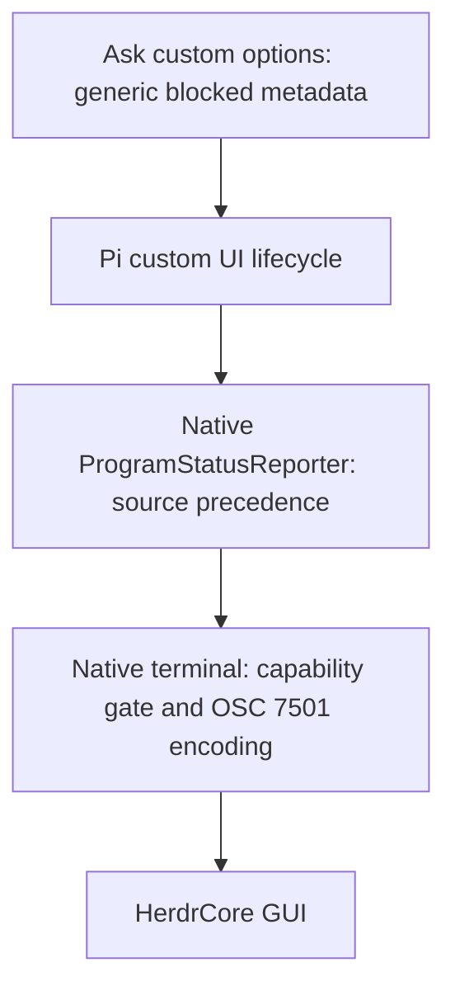
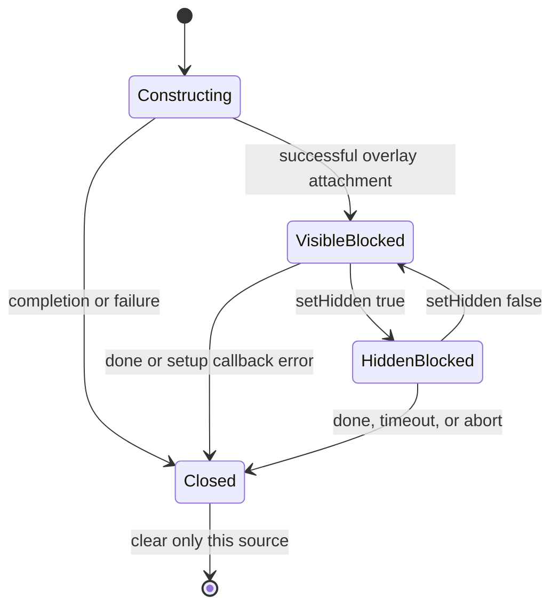

# Ask User Program Status - Plan

## Goal Capsule

Make unanswered `pi-ask-user` custom questions report native `blocked` status to HerdrCore, including the default overlay.
The request and Product Contract govern behavior; the Planning Contract governs implementation.
Use the maintained public bootstrap in this checkout, not the absent canonical dotfiles directory or an active personal-Pi installation.
Execution is implementation and isolated testing only; the parent owns Beads `projects-icy`, review, and any later publication or deployment.
Stop for an incompatible pinned dependency or a required scope change rather than weakening patch guards or adding another status transport.

## Product Contract

### Summary and Problem Frame

`pi-ask-user` emits legacy `herdr:blocked` events but supplies no native blocking metadata to its custom UI.
Pi 1.5.0 also ignores custom-UI blocking metadata in overlay mode.
HerdrCore consumes Pi's native OSC 7501 status, so the default Ask overlay can wait for an answer without showing as blocked in the GUI.
Fix the two missing connections without changing the question UI or adding a bridge.

### Requirements

**Waiting and resolution**

- R1. Single-question and batch custom prompts report `state=blocked`, `kind=question` in both default overlay and explicit inline modes.
- R2. Hiding an unanswered Ask overlay does not clear blocking; answering, cancellation, timeout, or abort clears only that prompt's blocking source.
- R3. Overlapping blocking overlays remain independent, including out-of-order closure and interaction with existing inline/login blockers; the native reporter determines precedence and restoration to working, compaction, idle, done, or error.
- R4. Synchronous or asynchronous factory failure, overlay setup failure, and throwing handle callbacks leave no stale blocking source. Once attachment returns a handle, failure removes that overlay; completion during construction or a handle callback cannot register blocking after closure. Pre-existing partial attachment failures inside TUI.showOverlay before it returns a handle are outside this status fix (see the implementation-time boundary below).

**Compatibility and boundaries**

- R5. Newly supplied custom-prompt metadata uses the fixed message `Waiting for user response`, never question text, options, context, or answers.
- R6. Preserve legacy `herdr:blocked` events, existing overlay geometry and hide controls, native inline stacking, tool results, and RPC/headless fallback behavior; overlays without blocking metadata remain non-blocking.
- R7. Respect native status capability detection and `PI_PROGRAM_STATUS=0`; require no new Herdr environment variables, socket access, credentials, or dependencies.
- R8. Apply fail-closed guarded patches to both pinned Pi execution forms and the pinned Ask package, with isolated regression evidence and no modification of active installed packages.

### Acceptance Examples

- AE1 (R1, R2, R5). A default Ask overlay opens, is hidden and reopened, then answered: the decoded native report remains blocked until the answer, contains only the generic message, then restores the underlying status.
- AE2 (R3, R6). Blocking overlays A and B overlap a native blocker: closing A while B remains open does not clear B; closing B exposes the remaining native blocker rather than forcing idle.
- AE3 (R4). A factory calls completion before returning, or `onHandle` completes and then throws: no late blocked report or leaked source remains.

### Scope Boundaries

No new bridge, OSC writer, reporter replacement, package upgrade, CI setup, tool schema change, UI redesign, deployment, commit, or push.
The already-native no-options `ui.input()` path and RPC fallback dialogs retain their existing title-based reporting; R5 applies to the new custom-prompt metadata, not a general native-dialog privacy redesign.
No persisted artifact format or HerdrCore code changes are needed.
Parent/child status aggregation is separate work tracked by the parent as `projects-al8`; child OSC records and root settlement behavior are not changed by this fix.

## Planning Contract

### Key Technical Decisions

- KTD1. Extend `InteractiveMode.showExtensionCustom` only for overlays that opt into `options.blocked`. Use a unique private source per invocation in the existing `ProgramStatusReporter.setBlocked` map; retain the inline `pushExtensionDialog` path. This reuses native precedence instead of implementing a competing status stack.
- KTD2. Register overlay blocking after successful attachment and before `onHandle`; remove it on close and rejection. Keep cleanup idempotent and mark rejected instances closed before any late completion can act. Visibility toggles are not resolution, so do not hook `setHidden` or focus changes. Scope exception cleanup to the overlay lifecycle rather than refactoring all dialogs.
- KTD3. Add typed blocking metadata in `buildCustomUIOptions` for inline, overlay, and its defensive default branch. Reuse the existing generic legacy message and keep `whileBlocked` unchanged. A plugin-only metadata change cannot fix the default overlay because Pi discards it today.
- KTD4. Keep SDK and bundled replacements separate where their emitted text differs, following `patch.mjs` exact-cardinality guards and syntax checks. Expect one owning SDK method and one owning bundled method; discover the bundle by the existing chunk scan, not a fixed chunk hash. Do not minify, regenerate, or copy the SDK implementation into the bundle.

### High-Level Technical Design

These sketches describe ownership and lifecycle, not implementation code.

### Assumptions and Risks

The existing native protocol is the integration boundary; successful OSC capture proves the bootstrap side, not an observed GUI session.
At planning time, only the parent's read-only `hc` 0.1.18 schema inspection was available. Later isolated Core evidence on the old `ae10922` base exercised Ask lifecycle and controlled child records, but did not render the GUI. That child-record evidence does not validate main's replacement `@tintinweb/pi-subagents` dependency; current-tree validation must be recorded separately.
Bundle minification makes exact anchors version-sensitive; compatibility failures must stop installation before activation.
The implementation may choose small test doubles for terminal/editor services, but must execute the real pinned lifecycle and reporter rather than reimplementing their logic in tests.

Implementation-time boundary approved by the parent: pinned TUI.showOverlay inserts its stack entry before evaluating visibility/focus/render callbacks and returns the removal handle afterwards. An internal callback failure in that interval can leave a pre-existing orphan without a handle. This fix does not patch TUI internals; it guarantees no new native blocking source on that path and overlay removal for failures after a handle was obtained. Partial-attachment rollback is a separate follow-up.

### Research Anchors

- `patch.mjs`: existing four update guards, bundled/SDK scan, exact Ask replacements, and JavaScript parse checks.
- `tests.mjs`, `test_runtime.mjs`, `test_footer.mjs`: isolated HOME checkout installation, pinned SDK imports, `jiti` aliases, native `zigpty`, and network denial. Main `56953c3` owns the public source directly and removed the old export allowlist and manifest.
- Dependency-relative under `node_modules/@earendil-works/pi-coding-agent/`: `dist/modes/interactive/interactive-mode.js` (`showExtensionCustom`, `showTopExtensionDialog`), `dist/bundle/chunks/*.js` (minified lifecycle), `dist/modes/interactive/program-status-reporter.js`, and `dist/core/extensions/types.d.ts` (`ExtensionUIContext.custom`). The latter currently documents blocking as inline-only; the local patch's overlay extension must be documented in this repo.
- Same dependency: `docs/extensions.md` (custom factories, `done`, visibility handles), `docs/terminal-setup.md` (program status), `examples/extensions/overlay-test.ts`, and `examples/sdk/06-extensions.ts` (registered commands/tools and resource loading). Use `done` to finish a custom overlay, not external `handle.hide()`.
- Dependency-relative `node_modules/pi-ask-user/index.ts`: `buildCustomUIOptions`, `runCustomPrompt`, `whileBlocked`, registered `ask_user.execute`, and batch handling. `settings.ts` confirms the default and environment/config precedence.
- Dependency-relative `node_modules/@earendil-works/pi-tui/dist/program-status.js`: OSC framing and base64 `msg` encoding; `dist/terminal.js`: native capability gate.
- External integration reference: https://github.com/herdrdev/herdr-core and https://www.superlogical.com/rex/docs/build/program-status (already researched by the parent).

## Implementation Units

### U1. Native overlay blocking lifecycle

- **Goal / requirements:** Implement R2-R4 and R6-R8 through KTD1, KTD2, and KTD4.
- **Files:** `patch.mjs`; new `test_ask_user_program_status.mjs`.
- **Approach:** Add guarded replacements for both real Pi builds. Import the real SDK `InteractiveMode` and reporter into the test, invoking the lifecycle with controlled UI/editor services and a recording terminal. Do not test a copied method or a mock reporter.
- **Execution note:** Establish a failing overlay-blocking regression against clean pinned dependencies before applying the fix in a disposable dependency tree.
- **Test scenarios:** (1) Blocking overlay opens/closes and plain overlay does not block. (2) Two distinct overlay messages close in both orders, with a native inline/login source preserved. (3) Clearing the last overlay restores working, compaction, idle, done, and error from actual reporter events. (4) Hide/unhide leaves blocking intact. (5) Sync throw, rejected factory, throwing dynamic options, throwing `showOverlay`, and throwing `onHandle` leave no source; an overlay whose handle was returned is removed on callback failure. Characterize the pre-existing internal partial-attachment limitation without treating orphaning as desired behavior. (6) Factory completion before return, late factory resolution after completion, completion inside `onHandle`, duplicate completion, and completion-then-throw do not produce post-close blocking. (7) Disposable copies with absent or duplicated patch anchors fail closed for each build; all successfully patched JS parses.
- **Verification:** Real SDK lifecycle assertions pass against an isolated patched Pi 1.5.0 tree; patch-cardinality and parse checks cover both emitted builds. U2 supplies actual bundled execution evidence rather than treating text assertions as behavioral proof.

### U2. Ask metadata and actual bundled terminal proof

- **Depends on:** U1.
- **Goal / requirements:** Implement R1, R2, and R5-R8 through KTD3; prove AE1-AE3 end to end across the changed seams.
- **Files:** `patch.mjs`; `test_ask_user_program_status.mjs`; `tests.mjs`; `README.md`.
- **Approach:** Extend existing Ask replacements without disturbing layout patches. Load the actual Ask extension with the pinned `jiti`/resource-loader patterns and capture its registered tool. Exercise that tool against native UI lifecycle services. Add the test to the existing temporary-HOME checkout installation flow alongside main's goal and link tests. Document the local overlay-status extension and its test boundary briefly in README; do not alter unrelated CI claims.
- **Test scenarios:** (1) Actual single-select, multi-select, and batch calls supply R5 metadata in default overlay and explicit inline modes. (2) Answer, Escape, timeout, already-aborted signal, and abort while hidden restore status and remove plugin timers/listeners; tool results and legacy true/false event pairing remain intact. (3) Invalid questions do not open UI or block; no-UI errors and RPC `custom()` fallback preserve existing behavior. (4) Optionless native input remains unchanged. (5) A disposable extension fixture wraps the real Ask registration and exposes a command that invokes its captured tool with the command context, without a model request. Launch the actual patched bundled CLI through pinned `zigpty`, invoke the command, hide/reopen the default overlay, answer it, and assert captured OSC 7501 blocked/question/generic-message then restoration. Repeat explicit inline and one cancellation path. Parse framed reports across PTY chunks and decode `msg`; sentinel question/context/answer text must not appear in the decoded status payload. (6) Use `PI_PROGRAM_STATUS=1` for deterministic positive PTY coverage and `=0` for a no-report negative case; unit coverage keeps native default gating unchanged.
- **Verification:** SDK/plugin scenarios and the real bundled CLI PTY smoke pass under temporary HOME with no provider credentials or network access. Bound waits, kill and close PTYs in cleanup, and remove fixtures even on failure. Export round-trip includes the new test file.

## Verification Contract

Implementation-time gates only; none are run during planning.

- Run `node --check patch.mjs` and syntax-check the new test script.
- Run `node test_ask_user_program_status.mjs <isolated-release>` using the installed pinned Node where needed; the argument is a disposable release created by the test harness, never the active personal-Pi release.
- Run `sh bootstrap.sh --checkout "$PWD" --test` for existing isolated checkout bootstrap, first-run, safety, goal, runtime, footer, link, and new status coverage. Preserve the existing network-denial guard around runtime checks.
- Record a red/green overlay regression and actual OSC payload evidence from the bundle, not just patch-text assertions. Report platform/dependency-download failures honestly rather than silently skipping acceptance cases.
- Live GUI inspection is optional later operator evidence, not a reason to deploy during this task. No `release:validate` script or skill-behavior evaluation applies.

### Branch-currency validation (2026-11-06)

Main `56953c3e2eb3342a13e84b9e3fd317bff542711e` was integrated after the old-base review. Its direct-checkout ownership architecture, deleted export files, workflow, goal/link patches and tests, and replacement subagent package remain authoritative. The reviewed Ask status implementation and regression script are unchanged; the test invocation joins main's network-denied runtime checks.

Fresh integrated validation passed all 16 bootstrap tests with no failures or skips, then passed the targeted SDK/plugin/bundled-CLI PTY test again against a new isolated installation. Logs are `/tmp/pi-ask-status-integration-20261106/bootstrap.log` and `targeted.log`. This is Linux x64 terminal-protocol evidence, not a new Core GUI or model-directed child run. Parent review and current-runtime Core Ask lifecycle evidence remain separate gates.

Read-only inspection of installed `@tintinweb/pi-subagents` 0.23.1 found no native child OSC reporter in `src` or `dist`. Its runner creates SDK sessions; its UI uses widget/footer status rather than terminal status records. Earlier Core child-record evidence used the removed package and cannot be transferred to this dependency. No reporting bridge or package change is authorized by this integration.

## Definition of Done

U1 passes SDK lifecycle, precedence, and failure scenarios plus compatibility checks for both pinned runtime surfaces.
U2 passes real-plugin and bundled-PTY scenarios, including hidden unanswered overlays and generic status payloads; checkout installation includes its test.
Existing bootstrap regressions pass, with changes limited to the named files and no active installation writes.
The diff contains no abandoned experiments, production test hooks, bridge code, dependency changes, or generated runtime artifacts.
Review reports distinguish protocol evidence from unavailable live HerdrCore GUI evidence; the parent retains publication and deployment ownership.
