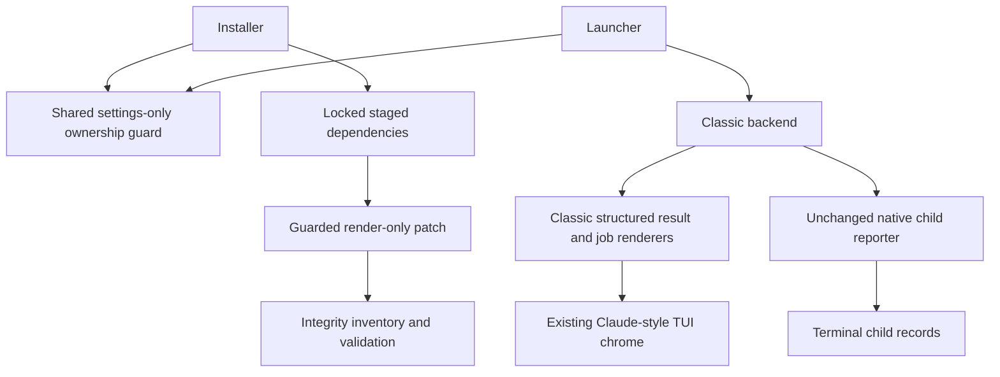
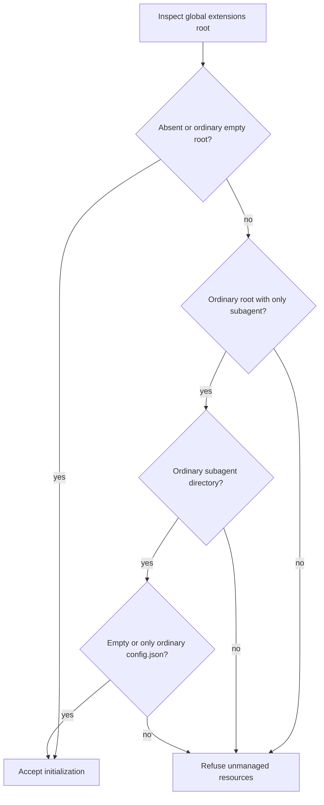
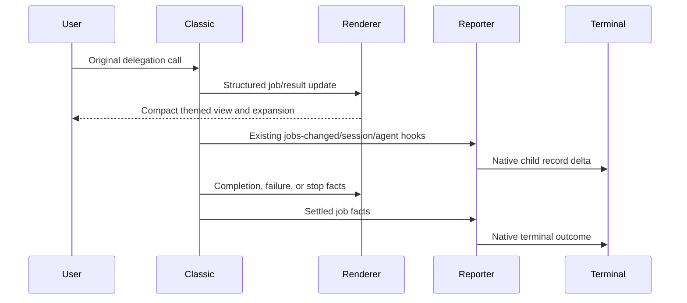
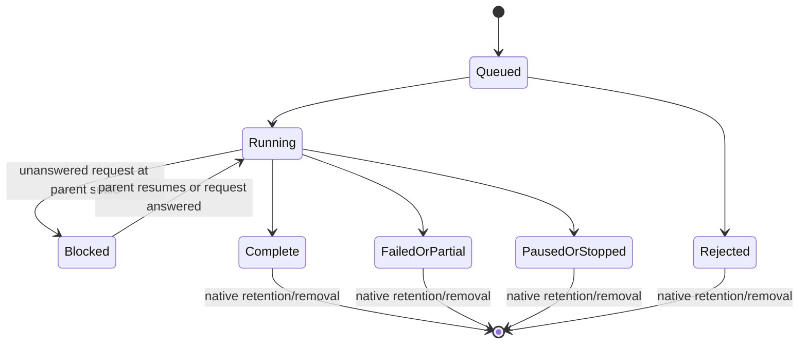
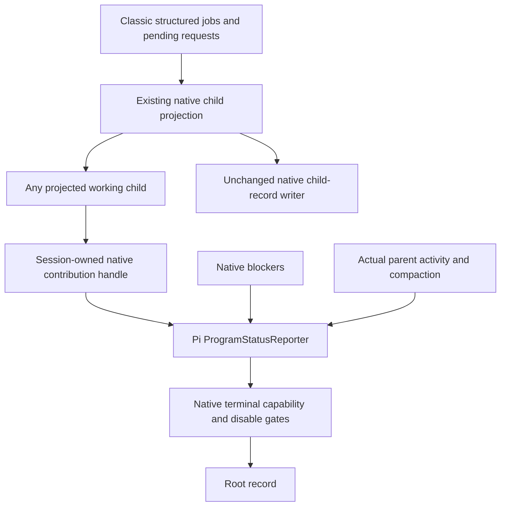
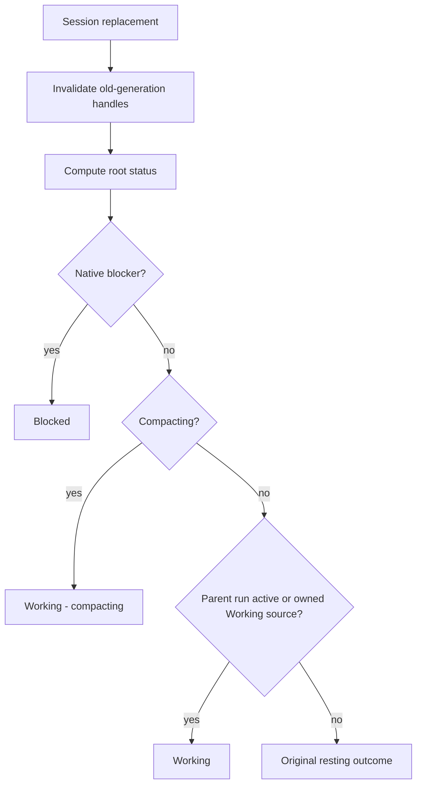

# Classic Subagents with Claude-style Presentation - Plan

**Target repo:** pi-config. **Baseline:** `56953c3`. **Branch:** `feat/classic-subagents-claude-ui`.

## Goal Capsule

- **Objective:** Restore `pi-subagents` 0.84.0 as the delegation backend, retain the replacement package's Claude Code-style terminal presentation, and aggregate background Working in Pi's native root reporter.
- **Authority:** User requirements and session-settled KTD1–KTD3 govern. Product behavior belongs to R1–R12; implementation mechanisms belong to the Planning Contract. Stop and contact the supervisor if evidence invalidates a settled decision or requires widening scope.
- **Execution profile:** Six dependency-ordered units: U1, U2, U3, U6, U4, U5. Characterize package behavior before changing rendering. Use isolated, credential-free fixtures for runtime proof; installation downloads are distinct from model/provider calls.
- **Write boundary:** Repository source and test writes stay in the allocated worktree. Caller-designated reports and this canonical plan are reporting exceptions. Installed releases and other worktrees are read-only. Disposable test HOME, caches, runtime directories, and unique Core sockets may live in a private temporary directory outside the checkout; remove fixture-owned resources after validation. This avoids copying the installer source into itself.
- **Delivery:** An independent own-fork PR and CI are authorized after the plan/review gate. No upstream PR is authorized. No merge, deployment, live release activation, live Core mutation, or changes to the separate Ask PR. Parent owns orchestration, Beads tracking, and final acceptance review.

---

## Product Contract

### Summary

Restore the classic delegation tools, workflows, and native child-status reporter. Recreate the replacement's compact terminal styling on the classic tool rows, background widgets, FleetView, and completion notices without replacing their execution or state ownership.

### Problem Frame

The backend switch traded away the user's preferred delegation surface to obtain a visual presentation. The two packages do not expose the same APIs or configuration schema. The replacement source inspected does not contain the classic native child OSC 7501 reporter consumed by terminal status integrations.

A plain dependency rollback is insufficient. The installed Claude-style UI has special handling for replacement `Agent` results and the `agents` widget, but it generically replaces other tools' result renderers. Classic uses `subagent`, `subagent-async`, and `subagent-fleet-status`. Its native preference location also conflicts with the bootstrap's blanket refusal of nonempty global extension directories.

### Requirements

**Backend and integration**

- R1. Load exactly one subagent backend: pinned `pi-subagents` 0.84.0, preserving its original tools, schemas, delegation APIs, packaged prompts/skills, and workflow execution.
- R2. Keep the native classic child OSC 7501 reporter as the sole child-status writer, with its existing state mapping, privacy limits, mode/TTY/disable gates, deduplication, and lifecycle cleanup.
- R3. Preserve classic execution controls: approval and trust boundaries, disabled features, tool activation, cancellation, background completion, supervisor requests, retention, and session replacement behavior.

**Presentation**

- R4. Present classic runs using the inspected replacement-plus-`pi-claude-code-ui` visual language: compact tool headings, status dots/spinners, aligned tree details, muted statistics, theme-aware state colors, and filled/hollow selection markers.
- R5. Keep distinctions among queued, running, completed, failed, partial, rejected, stopped, paused, and blocked states readable without color alone; do not replace classic semantics with replacement status names.
- R6. Preserve expandable output, workflow detail, Fleet inspection/steer/stop controls, and user visibility settings while keeping rendered lines within terminal width across resize and theme changes.

**Preferences and ownership**

- R7. Preserve existing user configuration bytes, including global and project replacement `subagents.json` files; do not automatically translate incompatible backend keys or create new replacement configuration.
- R8. Permit only the approved native settings-only exception under the global extension directory, without permitting unmanaged extension code or symlinks; preserve absent/empty initialization behavior.
- R9. Retain unrelated current-main pins, defaults, installer ownership, skill-pack selection, progress output, footer, link styling, goal completion, Ask overlay, launcher management routing, integrity checks, and HumanLayer isolation.

**Proof and delivery**

- R10. Supply deterministic render tests, actual pinned-runtime lifecycle proof, and isolated native root/child-record evidence before claiming completion; publish only sanitized evidence in an own-fork PR with CI results and no merge/deployment.

**Parent Working aggregation**

- R11. Pi's native root reporter shows Working when any owned background child projects to classic's existing working state, without changing native blocked or compaction precedence. Removing a contribution must preserve other sources, actual parent work, and the parent's original resting outcome.
- R12. Aggregate Working only: child attention stays on child records and never creates a new root Needs-you alert. When all children project to blocked or terminal states, restore actual parent run/resting state. No child content enters root messages.

### Actors and Flows

- A1. Terminal user delegates work, views progress, opens Fleet, and changes ordinary preferences.
- A2. Parent/child agents use classic tool and workflow contracts; rendering must not alter model-facing results.
- A3. Terminal status consumer reads native child records independently of the TUI grid.
- A4. Installer/launcher enforces managed resource ownership.

- F1. A4 installs into a staged release, verifies patches and inventory, preserves preferences, and makes only the managed package available. Covers R1, R7–R9.
- F2. A1 or A2 starts classic single/background/workflow work; classic owns execution, updates, results, and controls while the renderer displays those facts. Covers R1, R3–R6.
- F3. Classic emits native child records while A3 observes them; session shutdown/replacement and disable settings retain their native meanings. Covers R2, R10.
- F4. Classic structured lifecycle facts contribute background Working to Pi's native root reporter; native blockers and parent run/compaction remain authoritative. Covers R11–R12.

### Acceptance Examples

- AE1. **Covers R1, R7–R9:** Given an existing replacement `subagents.json` with explicit false values, unknown fields, and nonstandard whitespace, install/rerun preserves it byte-for-byte, does not seed replacement keys, and loads only classic.
- AE2. **Covers R8:** Given an ordinary global `extensions` directory containing only an ordinary `subagent` directory with only ordinary `config.json`, both installer and launcher accept it and the real Pi loader discovers no executable extension there. Adding `index.ts`, `index.js`, a package manifest, another file/directory, or any symlink causes refusal.
- AE3. **Covers R4–R6:** Given the same synthetic worker facts at widths 24, 40, 80, and 120, tool and widget views retain an identifiable state, fit the supplied width, and expand to the original detailed output. A failed or partial child never appears completed.
- AE4. **Covers R2:** Given root Pi is idle and a controlled classic background job is running, isolated Core reports a child `working` record alongside a native root `working` record produced by R11, without a second root writer. Completion becomes `done`; stopped/paused become `idle`; failed/partial/rejected become `error`.
- AE5. **Covers R2, R3:** Given a child supervisor question, the reporter marks it blocked only after the parent settles without answering. Parent activity and subsequent reply clear that blocked projection according to native behavior.
- AE6. **Covers R3, R6:** Given Fleet or async widgets are disabled, they remain hidden after installation/reload, but execution and native reporting retain their own independent gates.

- AE7. **Covers R11–R12:** With an otherwise idle root and two working children, the root reports Working. Completing one leaves Working; completing the last restores the root's prior idle/done/error state. A real parent run cannot become idle when a child completes.
- AE8. **Covers R11–R12:** A native dialog or login remains blocked despite background work. A child supervisor request that becomes blocked after parent settlement removes that child's Working contribution without creating root blocked; replying or parent activity restores the native child working projection.

### Scope Boundaries

In scope: package/lock change, settings-only ownership exception, removal of replacement-specific seeding, narrowly guarded renderer compatibility, a local pinned native root contribution seam and classic lifecycle wiring, regression tests, and migration/validation documentation.

Not in scope: a replacement orchestration engine; new OSC writers; legacy bridges; parsing terminal screens as a state source; cloning replacement APIs, scheduling, or retention behavior; wholesale UI vendoring; changing provider defaults; automatic config conversion; private agents; unrelated dependency updates.

#### Deferred to Follow-Up Work

- Existing Ask status PR remains separate and unmerged; do not copy its fix or status fixture behavior into this branch.
- Herdr GUI PR636 was closed unmerged at the user's request. No GUI/sidebar change or further upstream PR is in scope. Validate native root and child records through unmodified isolated Core; do not claim graphical end-to-end verification.
- Publishing a release pin or changing a downstream consumer installation is later deployment work, not this PR.

---

## Planning Contract

### Key Technical Decisions

- KTD1. **Restore classic 0.84.0.** (session-settled: user-directed — chosen over retaining the replacement backend and adding native reporting: the user prefers classic delegation workflows and authorized switching back.) Implements R1–R3. Use the prior `ae10922` dependency as provenance, not as a wholesale tree rollback.
- KTD2. **Retain/recreate Claude-style presentation.** (session-settled: user-directed — chosen over a plain rollback to the old visual design: styling was the stated reason for the earlier backend switch.) Implements R4–R6. The reference is actual replacement 0.23.1 source composed with `pi-claude-code-ui` 1.0.109, not imagined Claude branding.
- KTD3. **Allow native settings only at the classic config location.** (session-settled: user-approved — chosen over a config-path relocation patch: native preferences should work without an additional maintained path patch.) Implements R7–R8. One shared guard must serve installer and launcher. For present paths, use `lstat` on the global extensions root, its `subagent` directory, and `config.json`; every component must have its expected ordinary type and none may be a symlink. At the root allow only `subagent`; inside it allow only `config.json`. Reject executable entrypoints, manifests, extras, wrong types, and dangling links. An absent root, an empty ordinary root, or an empty ordinary `subagent` directory is accepted. Do not create or rewrite classic config merely to style the UI. Preserve the existing configured-extension and package-declaration guards.
- KTD4. **Patch rendering seams, not tool execution.** Implements R1–R6 in U3; U6 separately owns the approved native status contribution seam. Add one repo-owned `subagents-ui-patch.mjs`, called from `patch.mjs` during staging. Patch the existing Claude UI to let the classic `subagent` result renderer run instead of its generic replacement and to classify the classic call as agent-family visual work. Adjust classic rendering functions for the required presentation, using existing structured job/result projections. Do not re-register tools, alter schemas, intercept execution, translate results to replacement objects, or infer state from ANSI lines. No new runtime extension, watcher, transport, or backend dependency is needed.
- KTD5. **Guard both published source and shipped bundle targets.** Implements R9–R10. Follow `goal-patch.mjs`: exact package versions and unique anchors, validation of all targets before any writes, dry-run support, repeat-application idempotence, and refusal of partial/unknown layouts. Classic's `pi.extensions` points at `bundle/index.js`, which imports chunks; patching `src` alone cannot change installed behavior. Identify chunk targets by module markers and guarded anchors, not by assuming filenames remain stable across a version bump. Keep modifications render-local and parse-check emitted JavaScript.
- KTD6. **Leave backend configuration distinct.** Implements R7. Remove only replacement-key seeding from `install.mjs`. Classic configuration stays at its native location and ordinary Pi `settings.json` retains its separate `subagents` namespace. The replacement file is retained as inactive rollback data; there is no claimed equivalence between `widgetMode`, `workflowsEnabled`, or `showCost` and classic settings. Document supported native preferences instead of translating them.

- KTD7. **Pi-only native root Working contribution.** (session-settled: user-directed — chosen over Herdr/sidebar aggregation and upstream PRs: the user wants the parent status fixed in Pi, with existing Needs-you priority.) Implements R11–R12. Add a local, pinned UI-context contribution handle backed by Pi's existing `ProgramStatusReporter`; native terminal capability detection and disable gates remain authoritative. Each handle owns only its Working contribution, with idempotent release and session-generation invalidation. Keep blocked and compaction precedence, then combine actual run activity with owned Working sources. No extra OSC writer, stdout interception, timer, new root attention policy, or legacy bridge.
- KTD8. **Reuse native child-state projection for aggregation.** Implements R2, R11–R12. Add a narrow optional Working-change callback at classic's existing reporter synchronization seam, using the same structured projection that emits child records. Do not duplicate or rename child state mappings. Bind the callback to a native root contribution handle during TUI session start and release on cleanup. Leave child encoding, record ownership, gates, deduplication, limits, and quit/non-quit clear behavior unchanged. U6 is the explicit exception to U3's render-only boundary.

### Assumptions

These are planning defaults, not additional user-settled decisions.

- Presentation parity means matching the reference's visual vocabulary on existing classic surfaces, not reproducing replacement interaction timing or every menu. Keep classic's inactive Fleet summary, inspection controls, and workflow topology; style the selected roster and details rather than introducing a second roster model.
- Where classic already supplies tree connectors, spinner frames, model/usage details, and expansion, reuse them. Change the smallest heading, glyph, spacing, framing, and renderer-routing seams needed to meet the visual criteria below.
- Optional estimates appear only when the existing classic model provides them. Never fabricate replacement cost/context values or call a provider to obtain decorative data.
- A deterministic mock model plus controlled reporter lifecycle is sufficient for this PR's runtime contract. It does not prove real-provider quality, billing, or remote service behavior.

### Evidence and Surface Comparison

Package-relative source paths below identify the inspected published packages. They are evidence locations, not instructions to edit installed references.

| Surface | Replacement 0.23.1 + Claude UI 1.0.109 | Classic 0.84.0 | Planned treatment |
|---|---|---|---|
| Tool identity | `Agent`, `get_subagent_result`, `steer_subagent`; specialized `AgentDetails` rendering | `subagent`, `bg_wait`, `subagents_enable`, supervisor channel; original schemas | Preserve classic names and execution. Use Claude call chrome and classic rich result data. |
| Tool rendering | Claude UI `patchToolExecutionRenderers` generically intercepts all non-core calls/results | `src/extension/index.js` delegates to `renderSubagentResult` or configured summary | Exempt only classic `subagent` results from generic replacement; preserve configured summary/rich choice. |
| Background widget | `src/ui/agent-widget.ts`: Agents heading, braille spinner, tree rows, activity line, bounded overflow | `src/tui/render.js`: `subagent-async`, adaptive/rows layout, workflow/nested rows, existing braille animation | Restyle structured render functions; keep classic row budgets, collapse, updates, cleanup, and RPC snapshot branch. |
| FleetView | `src/ui/fleet-list.ts`: below-editor main/agent list, filled/hollow bullets, elapsed/token tail | `src/tui/fleet-status.js`: inactive summary, active tree roster, `>` selection, right-aligned usage | Match filled/hollow selection and row spacing with semantic colors. Preserve classic inactive summary, nesting, and key handlers. |
| Workflow card | `src/ui/workflow-card.ts`: phase tree, grouped statuses, compact metrics | Classic workflow projections, checklist/lane/host-step details and expansion | Apply the same tree/header language to existing projections; retain richer classic outcomes and controls. |
| Completion/attention | Replacement `subagent-notification` styled as a tool-like notice | `src/tui/subagent-messages.js`: `[subagent]` boxed headline and expandable typed message/entry views | Restyle framing/headline only. Keep original message types, parsing, body, click/expand behavior, and attention text. |
| Status consumer | No native reporter found in inspected replacement source | `src/integrations/program-status.js`, wired from extension lifecycle/job changes | Leave reporter implementation unchanged; validate independently of UI. |

The native classic reporter caps records at 64, sorts active work first, hashes sanitized workflow keys, emits only changes, and never includes task prompt text in its message. Its `dispose('quit')` intentionally does not emit per-child clears; non-quit replacement clears owned records. Preserve this distinction rather than imposing a new cleanup policy.

The ownership exception is supported by pinned Pi discovery behavior: `dist/core/extensions/loader.js` loads root `.ts`/`.js`, or a child directory's `package.json` extension entries / `index.ts` / `index.js`. It does not treat a lone `config.json` as an extension. Discovery follows some symlinks, which is why KTD3 rejects them independently of Pi.

**History correction:** `56953c3` is the current baseline and link-style fix. The backend switch is in `7d4f019`, which also changed source ownership. `defaults.json` at `ae10922` already matches current main. Do not revert that ownership commit or replace current defaults.

### High-Level Technical Design

The diagrams specify boundaries and preserved lifecycle behavior, not implementation code.

The last diagram is a display projection of native facts. It does not introduce a scheduler or modify classic state transitions.

Root aggregation retains a single writer and combines independent ownership:

### Visual Acceptance Samples

These are expected fixture compositions derived from the source comparison, not screenshots or claims of observed runtime output. Use fixed names such as `worker` and synthetic tasks such as `Inspect fixture`.

- **Foreground running:** Claude-style `Subagent` heading with pending dot/breathing treatment; child name and explicit running activity below it; muted real metrics when available. Expansion retains original classic task/output/tool details.
- **Background running:** compact Agents/background heading with tree-aligned child and activity rows. One child and mixed parallel/workflow cases use consistent indentation. Overflow remains counted and reachable through classic expansion/Fleet.
- **Completed and failed:** compact terminal row/notice with textual outcome. Success and error differ by text as well as glyph/color. Partial, stopped, and paused are not displayed as completed.
- **Fleet selection:** main and selected child use filled markers; unselected entries use hollow markers. The label and native state remain readable with stats aligned at normal widths. Keyboard focus rules and inactive summary remain classic behavior.
- **Attention and workflow:** blocked request, rejection, partial lane, and completed lane remain distinct. The expanded classic view retains diagnostic reasons, output links, and controls; styling does not suppress them.

For 24/40-column terminals prioritize identity and state over optional metadata. At 80/120 columns show available details without artificial filler. At widths 0, 1, and 2 rendering must not throw or exceed the supplied width; readable text is not required when no space exists. Strip decorative ANSI for a separate plain-text assertion, and use theme-provided colors rather than fixed branding colors.

### System-Wide Impact and Risks

- The guard is an ownership policy, not a sandbox against a concurrent same-user attacker. Do not claim it prevents filesystem replacement between validation and Pi startup. Exact type/entry checks and real discovery tests protect the intended managed-install boundary.
- Claude UI overrides Pi rendering prototypes. Its generic result interception must be exercised with the actual installed tool component, not just isolated helper tests, or classic workflow details can silently disappear.
- Classic ships compiled source plus bundled chunks. Source-only tests can give false confidence; execute the manifest entrypoint and verify patched bundle behavior.
- Restoring packaged prompts/skills can expose resource collisions that replacement did not have. Check diagnostics in both `pi` and `pih`; do not suppress collisions or remove unrelated resources to force a pass.
- Existing replacement preferences have no safe automatic equivalence. README must make their inactive/retained status clear and explain the native classic location, including independent widget and reporter switches.
- Renderer tests must distinguish prompt text allowed inside the local transcript from forbidden prompt text in external child-status messages.
- Isolated validation uses a private external temporary root for HOME/TMPDIR/XDG/cache/socket paths. The installer copies its source and cannot install beneath that source; temporary fixtures are authorized outside the repository, but source edits remain worktree-only.
- Parent aggregation must not become a second activity state machine. The classic reporter's existing working projection controls contributions; native root blockers, compaction, and actual parent activity control final precedence. Session-generation invalidation prevents a captured old handle from reviving stale work.

### Deferred Implementation Questions

- Exact unique patch anchors and bundle module occurrences must be confirmed against the fresh integrity-locked install. Unknown layout is a stop condition, not permission to broaden replacements.
- Final renderer snapshots and terminal captures must be produced during implementation. No runtime/visual pass is claimed by this plan.
- Availability and version of the isolated Core executable are environment-dependent. If unavailable, report that gate unverified and provide reproducible invocation prerequisites; do not substitute live Core or call a pure reporter test end-to-end proof.

---

## Implementation Units

### U1. Admit only native classic settings data

**Goal:** Make native classic preferences compatible with managed ownership without admitting extension code.

**Requirements:** R7–R9; KTD3; F1; AE2.

**Dependencies:** None.

**Files:** Create `extension-ownership.mjs`, `test_extension_ownership.mjs`. Modify `install.mjs`, `launch.mjs`, `tests.mjs`, and `test_runtime.mjs`.

**Approach:**
1. Extract the nonempty-directory ownership decision into a shared helper implementing KTD3. Keep installer/launcher error context useful and preserve their separate settings/package guards.
2. Treat missing and empty ordinary directories as valid initialization states. Do not create files as a side effect of validation.
3. Add a real pinned SDK discovery assertion for the accepted data-only directory and route it through the existing isolated runtime test.

**Patterns to follow:** Existing refusal checks in `install.mjs`/`launch.mjs`; `test_safety.mjs` temporary fixtures; `test_runtime.mjs` actual `DefaultResourceLoader` diagnostics.

**Execution note:** Add rejection and discovery characterization before allowing the exception.

**Test scenarios:**
- Covers AE2. Absent root, empty root, empty `subagent`, and ordinary config-only directory pass in both callers.
- Root file, child file, config directory, root/child/config symlink, and dangling symlink fail without following or modifying the target.
- Root `.ts`/`.js`, sibling directory, nested directory, hidden extra file, `index.ts`, `index.js`, and `package.json` all fail.
- A sentinel external symlink target remains untouched after installer refusal.
- Real Pi discovery with an allowed directory returns no executable resource from it; explicitly managed packages still load.
- Existing global/project package guards and configured positive-extension refusal still fail as before.

**Verification:** Installer and launcher share one policy; permission/error cases fail closed; config-only preferences survive launch/rerun; no unmanaged code is discovered.

### U2. Restore the pinned backend without converting preferences

**Goal:** Switch package ownership to classic while retaining current-main bootstrap behavior.

**Requirements:** R1, R3, R7, R9; KTD1, KTD6; F1; AE1, AE6.

**Dependencies:** U1.

**Files:** Modify `package.json`, `package-lock.json`, `install.mjs`, `tests.mjs`, `test_runtime.mjs`. `defaults.json` and `manifest.json` are review-only unless a separately approved necessity is found.

**Approach:**
1. Replace only the direct subagent dependency with exact classic 0.84.0. Regenerate the affected lock graph with lifecycle scripts disabled and review unrelated resolution drift.
2. Remove replacement-specific default seeding. Leave both replacement files and existing classic config untouched per KTD6.
3. Let the dependency-driven launcher select classic normally; do not add a parallel extension loader or revive the removed export/private ownership model.
4. Update inventory/discovery assertions for classic tools, commands, packaged prompts/skills, and absence of replacement registration.

**Patterns to follow:** `ae10922` package provenance; current staged `npm ci`, patch, integrity inventory, and activation sequence; current installer preservation tests.

**Test scenarios:**
- Fresh install has classic 0.84.0 and no replacement package/`Agent` registration; classic `subagent`, loader, wait, and supervisor surfaces are discoverable under their native activation rules.
- Covers AE1. Existing replacement config is preserved as exact bytes after install, same-release rerun, and optional HumanLayer/skill-pack addition.
- Existing classic config with explicit `fleetView`, `asyncWidget`, `programStatus`, and disabled-feature values is unchanged.
- Fresh install does not create `subagents.json` or a classic config file solely to seed visual settings.
- Managed `list` reports the new inventory; `config`, auth/MCP dispatch, offline resource discovery, integrity/tamper refusal, and `pih` isolation still behave as current main.

**Verification:** Lock and inventory agree, only one backend loads, original APIs are restored, and unrelated pins/defaults/preferences remain unchanged.

### U3. Apply the minimal Claude-style rendering compatibility patch

**Goal:** Retain classic structured rendering and style its visible surfaces consistently with the inspected reference.

**Requirements:** R1–R6, R9; KTD1, KTD2, KTD4, KTD5; F2; AE3, AE6.

**Dependencies:** U2.

**Files:** Create `subagents-ui-patch.mjs`, `test_subagents_ui_patch.mjs`, `test_subagents_ui.mjs`. Modify `patch.mjs`, `tests.mjs`.

**Approach:**
1. Record characterization fixtures from classic result/job/message shapes and the replacement's visual compositions before altering rendering.
2. In the staged `pi-claude-code-ui/extensions/index.ts`, preserve its generic Claude-style call chrome for `subagent`, add the classic name to its agent-family visual classification, and route `subagent` results to the original registered renderer. Leave unrelated tools and replacement-compatible branches alone.
3. Patch render-local classic functions in `src/tui/render.js`, `src/tui/fleet-status.js`, and `src/tui/subagent-messages.js` plus their corresponding shipped bundle modules. Limit edits to heading/glyph/spacing/framing and rendering of existing structured facts. Use the Visual Acceptance Samples as the target, retaining richer classic detail and configured summary mode.
4. Preserve `renderWidget`'s RPC snapshot branch, mounted component identity, cache invalidation, input handlers, disposers, timers, and workflow coverage bookkeeping. Do not add transport or state listeners.
5. Implement KTD5 as one atomic validation/write pass. Keep the native reporter, execution modules, public API modules, and existing Ask/goal/link patches unchanged.

**Patterns to follow:** `goal-patch.mjs` all-target validation/dry-run/idempotence; `test_links.mjs` installed UI implementation tests; Pi theme/component width and invalidation contracts.

**Execution note:** Test the actual Pi tool execution component with classic and Claude UI loaded together. Testing a newly written helper in isolation does not prove the interception fix.

**Test scenarios:**
- Version mismatch, missing/duplicate anchor, unexpected bundle module count, and mixed partial patch fail before any target changes; dry run changes nothing; second application changes nothing.
- Source and shipped bundle produce equivalent fixture views; package manifest loading reaches the patched implementation.
- Covers AE3. Single, parallel, nested, workflow, management, empty, and malformed optional detail fixtures render at 24/40/80/120 columns without hiding state or exceeding width.
- Running, queued, completion, failed, partial, rejected, paused, stopped, detached, and supervisor-blocked samples remain semantically distinct.
- Expanded rich results preserve output, failure reason, artifact references, and child/host-step information; configured summary mode remains one stable result row.
- CJK, emoji, combining marks, long names, multiline errors, and embedded terminal-control input do not break widths or bypass classic sanitization.
- Dark, light, and system/fallback themes render distinguishable statuses; plain-text output names outcomes; invalidation and resize do not retain stale colors or measurements.
- Covers AE6. Widget/Fleet disable settings, no-UI modes, and RPC snapshots remain native; widget cleanup and input focus behavior are unchanged.
- Existing footer, link, goal, Ask overlay, and ordinary tool rendering tests remain green.

**Verification:** Reference-derived visual samples are reproducible from the real installed components; render-only diff boundaries are independently reviewable; no execution/schema/result-content or reporter changes are needed.

### U6. Aggregate background Working through Pi's native root reporter

**Goal:** Show background activity on the existing root record without competing writers or a new attention policy.

**Requirements:** R2–R3, R10–R12; KTD7–KTD8; F3–F4; AE4–AE5, AE7–AE8.

**Dependencies:** U2, U3.

**Files:** Create `subagents-status-patch.mjs`, `test_subagents_status_patch.mjs`, `test_subagents_parent_status.mjs`. Modify `patch.mjs`, `tests.mjs`, and the U4 runtime/status/Core fixtures.

**Approach:**
1. Follow KTD5's atomic patch guards for pinned Pi 1.5.0 unbundled runtime, declarations, and shipped CLI bundle modules; apply equivalent guarded classic source/bundle changes.
2. Expose a narrow local UI-context contribution handle through the existing native reporter. Keep declaration/runtime parity and no-op behavior in non-TUI contexts; do not advertise an upstream API.
3. Reuse classic reporter synchronization under KTD8. Only projected working jobs contribute. A pending request is not blocked until classic's existing parent-settled rule says so.
4. Keep source ownership in the native handle. Release is idempotent, overlapping sources are independent, and reset invalidates old-generation handles. Shutdown/reload/new/resume/fork remove owned contributions without clearing a live parent or another owner.

**Patterns to follow:** Pi `dist/modes/interactive/program-status-reporter.js`, `InteractiveMode.createExtensionUIContext`, extension runner no-op context and stale-context guards, terminal `setProgramStatus` capability gating; classic `src/integrations/program-status.js` and `src/extension/index.js` tracker/session wiring. Bundle module targets must be discovered by guarded contents, not fixed chunk names.

**Execution note:** Observe a failing native root-state regression before adding the contribution seam; separately characterize unchanged child records.

**Test scenarios:**
- Covers AE7. Idle root becomes Working for one source; two sources overlap; releasing either leaves Working until the final source releases, then restores prior idle/done/error outcome.
- Covers AE8. Native dialog/login blocked and compaction retain precedence. Clearing a native blocker reveals background Working if it remains; releasing background work cannot clear native blocked or actual parent activity.
- Covers AE5, AE8. Pending child requests before settlement continue working; settled unanswered requests project blocked and no longer contribute; parent activity/reply restores projection; completion/cancel removes contribution.
- Reset and each session replacement invalidate old handles; repeated disposal is safe and cannot clear a newer owner's work. No accumulated subscription or stale blocker is introduced.
- Program-status disabled, unsupported terminal, dumb terminal, and RPC/print/JSON modes retain native output gates. Widget/Fleet preferences remain independent.
- Source and bundle apply atomically, parse, agree on behavior, and refuse partial/unknown layouts. Actual pinned CLI plus classic entrypoint exercise the wiring, not only the new method in isolation.
- Unmodified isolated Core sees native root Working with native child records, while separate Ask PR1 code remains absent. Test native blocked precedence directly; combined Ask runtime is optional evidence, not permission to copy its fix.

**Verification:** Native root output proves R11–R12 in the actual pinned runtime. Child reporter records retain byte-equivalent projection and lifecycle behavior except the separate optional callback; only Pi's terminal writes the root record.

### U4. Prove original lifecycle and native child records in isolation

**Goal:** Demonstrate backend and status behavior in the actual pinned runtime without live-session mutation or provider access.

**Requirements:** R1–R3, R5–R6, R10; KTD1, KTD4; F2–F3; AE4–AE6.

**Dependencies:** U3, U6.

**Files:** Create `test_subagents_runtime.mjs`, `test_subagents_status.mjs`, `test_subagents_core.mjs`, and `test-fixtures/subagents-runtime.ts`. Modify `tests.mjs` and `test_runtime.mjs` where harness integration is needed.

**Approach:**
1. Reuse the existing installed SDK/zigpty harness. Resolve package/runtime paths from the supplied disposable release, not machine-specific references.
2. Load a test-only deterministic model through the pinned runtime's provider extension seam and exercise classic single foreground and detached background work plus a small scripted workflow. Make the fixture available to child loadouts through supported classic child-extension configuration. Deny network and use no user credentials.
3. Separately drive controlled job/pending-request facts through the unchanged native reporter to cover exact state transitions and gates. Label this reporter-level proof separately from actual child execution.
4. Adapt the named prior Core precedent's isolation design, not its Ask scenario or hardcoded paths. Start a fresh Core instance with worktree-local HOME, socket, session, and XDG roots, assert it is empty, then run pinned Pi under its PTY and inspect actual child records through its supported CLI/API.
5. Capture sanitized terminal views for the visual samples, plus structured records for status. Do not parse terminal text to infer job state. Teardown only fixture-owned processes and directories in `finally` paths.

**Patterns to follow:** Existing `test_runtime.mjs` native PTY and loader test; `tests.mjs` allowlisted environment/network denial; classic reporter's injectable write/env/TTY options; prior isolated Core fixture supplied by the caller.

**Test scenarios:**
- Actual classic single child returns deterministic output and structured details; background child completes and can be inspected/waited; scripted workflow launches and settles controlled children with original result shapes.
- Invalid agent/preflight/disabled-feature input fails through classic validation without launching work. Cancellation and stop preserve native outcomes and leave no fixture-owned child processes behind.
- Reply/blocked projection follows AE5; parent processing does not falsely mark an unanswered request as user-blocked before settlement.
- Covers AE4. Real isolated Core receives `subagents/` child records alongside the native aggregated root Working record, then observes terminal outcomes and restoration of the parent's prior status. The fixture extension does not create its own OSC writer.
- Reporter tests cover all status mappings, active-first 64-record bound, deduplication, invalid/long workflow keys, UTF-8 length bounds, prompt privacy, disappeared-job clears, non-quit disposal clears, quit disposal behavior, and resume resend/listener removal.
- `programStatus:false`, `PI_PROGRAM_STATUS=0`, non-TTY, dumb terminal, RPC, print, and JSON gates emit no child status sequences; widget settings do not disable reporter independently.
- Reload/new/resume/fork/shutdown cases do not accumulate renderer timers, terminal listeners, or duplicate widgets; idle captures remain stable after completion.
- Fleet keyboard navigation, inspector entry/exit, expansion, and resize work without stealing input from nonempty editor or other focused UI.

**Verification:** Evidence separates real child execution, controlled reporter coverage, real Core consumption, and visual TUI capture. No model-provider request, live socket, or installed-release mutation occurs. An unavailable Core gate is reported as unverified, not passed.

### U5. Document migration and complete release-equivalent validation

**Goal:** Make the change reviewable and reproducible while preserving unrelated main features.

**Requirements:** R7–R10; KTD1–KTD6; AE1–AE6.

**Dependencies:** U4.

**Files:** Modify `README.md`, `tests.mjs`; update only necessary test wiring in `.github/workflows/pi-bootstrap.yml` if existing bootstrap discovery cannot include the new deterministic checks.

**Approach:**
1. Replace replacement-engine/seeding documentation with classic inventory, native preference location, the exact data-only ownership exception, retained inactive replacement config, and supported visual behavior.
2. Document guarded patch targets and failure policy. Explain that upstream version upgrades require re-review rather than bypassing guards.
3. Include deterministic tests in the existing bootstrap CI path. Keep optional Core integration explicitly gated with prerequisites and a reported result, rather than adding an external service dependency to every platform job.
4. Assemble sanitized rendered samples and runtime/record evidence for independent review. Record browser applicability and local/CI platform limitations.

**Patterns to follow:** README Source ownership, Patch maintenance, and Validation sections; existing Linux/macOS bootstrap matrix and no-provider test posture.

**Test scenarios:**
- Full isolated bootstrap passes fresh install, rerun, add-later HumanLayer, skill retention, command conflicts, package guards, archive attacks, tamper checks, footer/goal/link tests, and new subagent assertions.
- Managed release inventory contains no accidental test dependency, private resource, reference-package copy, or duplicated backend.
- Security audit covers the new lock graph; unexpected findings or unrelated lock churn are reported for review, not hidden by broad updates.
- CI reports each configured platform independently; a configured matrix is not described as a pass without completed results.

**Verification:** README matches tested behavior, all required evidence is attached to the independent PR, and no merge/deployment or Ask/Herdr code change occurs.

---

## Verification Contract

The following commands name existing or planned test entrypoints, not a claim that they have already run. Execute them with credential-free, private disposable HOME/TMPDIR/XDG/cache roots outside the checkout and the disposable release's pinned Node. Package downloads may use the network; runtime/model tests must not.

| Gate | Entry point / method | Units | Pass condition |
|---|---|---|---|
| Ownership | `node test_extension_ownership.mjs` plus pinned loader assertion | U1 | Exact allowlist passes; all extra/code/symlink cases refuse; allowed data discovers no code. |
| Patch guards | `node test_subagents_ui_patch.mjs` | U3 | Versions/anchors guarded, all-target validation, dry run, repeat application, and partial-layout refusal proven. |
| Visual rendering | `node test_subagents_ui.mjs <release>` | U3 | Actual installed renderer/component fixtures meet width, state, expansion, theme, and reference-composition criteria. |
| Classic execution | `node test_subagents_runtime.mjs <release>` | U2–U4 | Pinned manifest entrypoint executes deterministic classic child/workflow paths without provider access. |
| Native reporter | `node test_subagents_status.mjs <release>` | U4 | Native state/gate/privacy/dedup/cleanup matrix passes without an added writer. |
| Parent Working | `node test_subagents_parent_status.mjs <release>` and pinned runtime/Core fixtures | U6 | Owned-source overlap, native precedence, child projection, and cleanup agree in source and bundle. |
| Isolated Core | `node test_subagents_core.mjs <release> <core-cli>` | U4 | Fresh isolated instance consumes actual native child records; fixture-only teardown succeeds. |
| Release-equivalent regression | `sh bootstrap.sh --checkout "$PWD" --test` | U1–U5 | Existing bootstrap and new deterministic tests pass in isolated HOME/TMPDIR; all current-main preservation checks pass. |
| Generated shell drift | `node generate-bootstrap.mjs --check` | U5 | No accidental bootstrap generation drift. |
| Dependency review | `npm audit --omit=dev` and reviewed lock diff | U2, U5 | Audit result recorded; no unapproved direct pin changes or unexplained lock drift. |
| Browser applicability | `ce-test-browser` pipeline scope/route gate | U5 | Not applicable: no web app, routes, or browser surface changes. Reassess final diff; terminal captures are not browser passes. |
| Independent review and CI | Parent-owned review; existing bootstrap matrix | All | No unresolved blocking findings; actual platform results attached, unavailable gates explicitly identified. |

**Browser gate assessment:** The skill and its pipeline orchestration reference were consulted. This branch's planned files affect a shell/Node bootstrap and terminal components only; package metadata supplies no web server or route. No browser driver/server was started. Repeat applicability against the final implementation diff, and do not add a browser stack to test a terminal-only change.

**Behavioral evaluation:** No skill instructions are being modified, so a skill-prompt evaluation suite is not required. Classic packaged prompt/skill discovery and agent tool/lifecycle parity are required under the runtime gates.

**Evidence rules:** Keep mock results labeled deterministic. Keep controlled-job results labeled reporter-level. Real Core consumption is stronger than emitted-byte assertions but is not graphical Herdr verification. Publish only synthetic task text and sanitized paths/records; never copy HOME, sessions, credentials, provider environment, or private agents.

---

## Definition of Done

- U1: Shared ownership guard passes exact-type/allowlist tests and actual Pi discovery proof.
- U2: Classic is the only loaded backend; configuration preservation and current-main regression assertions pass.
- U3: Guarded source/bundle render changes meet the Visual Acceptance Samples with real installed component evidence.
- U6: Native root Working aggregation passes overlap, blocked/compaction precedence, attention transition, gate, and session cleanup tests; unmodified Core observes actual root/child records.
- U4: Deterministic original API/lifecycle tests and native reporter tests pass; isolated Core and TUI evidence is recorded with honest limits.
- U5: Documentation and test wiring match the implementation; dependency audit, independent review, and actual CI outcomes are attached to a separate PR.
- The diff contains no abandoned experiment, large vendored UI/backend copy, second status writer, live path, secret, private artifact, unrelated fix, or unapproved pin change.
- Fixture processes and private scratch artifacts are cleaned up. User preferences and protected installations are unchanged.
- No merge, deployment, release activation outside disposable test HOME, or changes to the separate Ask/Herdr work occur.

---

## Appendix

### Research Sources and Constraints

- Repo: `package.json`, relevant `package-lock.json` dependency entries, `defaults.json`, `manifest.json`, `install.mjs`, `launch.mjs`, `patch.mjs`, `goal-patch.mjs`, `README.md`, `tests.mjs`, `test_runtime.mjs`, `test_links.mjs`, `test_goal_patch.mjs`, and `.github/workflows/pi-bootstrap.yml`.
- History: `ae10922` supplies the classic pin and unchanged default settings; `7d4f019` owns the switch/source-ownership change; `56953c3` supplies current visible Markdown link styling.
- Read-only published classic reference: `pi-subagents` 0.84.0 package manifest, `src/extension/config.js`, `src/extension/index.js`, `src/tui/render.js`, `src/tui/fleet-status.js`, `src/tui/fleet.js`, `src/tui/subagent-messages.js`, `src/integrations/program-status.js`, and corresponding bundled module locations.
- Read-only replacement reference: `@tintinweb/pi-subagents` 0.23.1 package manifest, `src/settings.ts`, `src/ui/agent-widget.ts`, `src/ui/fleet-list.ts`, and `src/ui/workflow-card.ts`.
- Existing styling: `pi-claude-code-ui` 1.0.109 `extensions/index.ts`, especially generic tool interception, agent result/notification helpers, and widget styling. Reuse its existing visual conventions; do not copy its package into this repo.
- Pinned Pi 1.5.0 `docs/extensions.md`, `docs/themes.md`, and `docs/tui.md` were read in full, along with complete `examples/extensions/widget-placement.ts`, `built-in-tool-renderer.ts`, and `message-renderer.ts`. `dist/core/extensions/loader.js` grounds the ownership exception. Conflicting generic UI-prompt prose is irrelevant here: native reporter behavior and this branch do not change Ask prompt status.
- Caller-supplied prior isolated Core fixture was inspected as a read-only precedent. Its Ask fixes and absolute runtime paths are not reusable branch content.
- CE config files, strategy/concept documents, and repository `docs` learning/plan corpus were absent in the inspected worktree. Configured artifact root therefore defaults to `docs`; the caller's authoritative output path overrides plan placement for this run. No second plan is created.

### Settled Decision Conflict Ledger

- KTD1: No invalidating evidence. Compatibility issue was the native settings location, resolved by approved KTD3 rather than a backend change.
- KTD2: No invalidating evidence. Full visual parity is not a package swap: generic Claude UI interception and different data contracts require guarded rendering adaptation. Classic semantics take precedence over misleading replacement-only labels.
- KTD3: Approved ownership exception is feasible under pinned discovery rules. Residual same-user filesystem-race limitations are stated in Risks, not represented as a sandbox guarantee.
- KTD7: The user superseded the GUI-consumer approach with Pi-only Working aggregation. The native reporter supports the required precedence locally; no existing public extension root-status API is present. U6 adds the narrow pinned contribution contract rather than introducing another writer.

### Revision Scope and Grounding

Product Contract changed: R10 restricts delivery to own-fork PRs; R11–R12 add user-directed Pi-only Working aggregation and explicitly exclude promotion of child attention into root alerts. Existing R1–R9 and KTD1–KTD3 retain their meaning. U-IDs remain stable; U6 precedes U4 in dependency order.

Pinned Pi 1.5.0 `ProgramStatusReporter.currentStatus` checks native blocked, then compaction, then actual run/resting state. `InteractiveMode.createExtensionUIContext` has working-indicator decoration but no root contribution API. The extension runner supplies no-op UI in noninteractive modes and rejects stale context access. Terminal `setProgramStatus` keeps capability detection and `PI_PROGRAM_STATUS` gating separate from the reporter. Classic's native reporter already calculates the settled-unanswered-request projection at its `sync` seam; U6 reuses that calculation rather than another state mapping.

Focused revision research and flow/confidence analysis ran inline because this worker cannot dispatch independent contexts. No independent corroboration is claimed. Local published source/docs suffice for this pinned local contract; no external API or upstream approval is required. Confidence analysis added generation invalidation, overlap ownership, Working-only attention semantics, source/bundle parity, and actual Core root-state verification. The host has no normal skill-invocation primitive for `ce-doc-review`: `skipped_reason: skill_unreachable`, zero fixes, no review findings claimed. Parent-owned review remains required.

### Review and Planning Evidence Limits

This is an implementation plan, not an implementation or test result. No source code, dependencies, installed releases, or live sessions were changed during planning. The generated worktree branch was safely renamed to the requested feature branch.

Local repository, agent-native, flow, and confidence analysis ran in one context because this worker's harness does not allow nested delegation. The confidence pass strengthened renderer interception, source/bundle parity, config symlink boundaries, and isolation/cleanup verification. It is not independent corroboration.

The host exposes no normal skill-invocation tool for `ce-doc-review`; its non-interactive review did not run. The documented handoff state is `skipped_reason: skill_unreachable`, with zero auto-applied fixes and no review findings claimed. Parent-owned independent plan review is required before source implementation. This does not leave a product/architecture question unresolved: the ownership decision is settled and the plan contract is implementation-ready, subject to that review gate.
